<a id="readme-top"></a>

<p align="center">
  
</p>

<h1 align="center">SoundBar</h1>

<p align="center">
  <b>Control the volume of every app on your PC from one small, tidy window.</b><br/>
  Turn the game down without touching your music, switch between speakers and headphones in one click,<br/>
  and even control it all from your phone.
</p>

<p align="center">
  <a href="#how-to-install"><b>Download</b></a> &nbsp;·&nbsp;
  <a href="#a-quick-tour">Quick tour</a> &nbsp;·&nbsp;
  <a href="#control-every-apps-volume">Features</a> &nbsp;·&nbsp;
  <a href="#bluetooth">Bluetooth</a> &nbsp;·&nbsp;
  <a href="#control-it-from-your-phone">Phone remote</a> &nbsp;·&nbsp;
  <a href="#keyboard-shortcuts">Shortcuts</a> &nbsp;·&nbsp;
  <a href="#common-questions">Help</a>
</p>

<p align="center">
  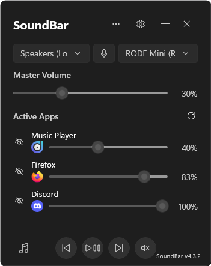
  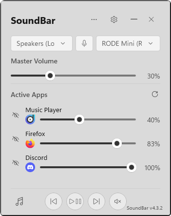
  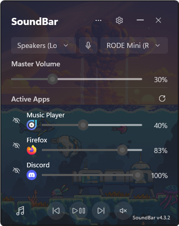
</p>

<p align="center"><sub>Works on Windows 10 and Windows 11. Free and open source.</sub></p>

---

## Contents

- [A quick tour](#a-quick-tour)
- [Control every app's volume](#control-every-apps-volume)
- [Speakers, headphones and microphones](#speakers-headphones-and-microphones)
- [Bluetooth](#bluetooth)
- [Music player](#music-player)
- [Control it from your phone](#control-it-from-your-phone)
- [Make it yours](#make-it-yours)
- [Keyboard shortcuts](#keyboard-shortcuts)
- [Handy extras](#handy-extras)
- [How to install](#how-to-install)
- [Common questions](#common-questions)
- [For developers](#for-developers)

---

## A quick tour

This is the main SoundBar window. Each number is explained next to it.

<table>
  <tr>
    <td width="320">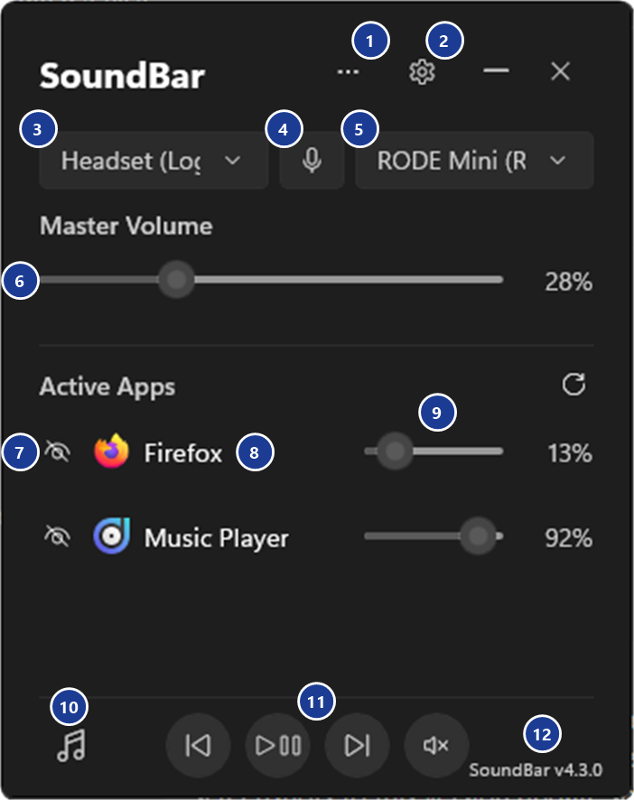</td>
    <td>
      <ol>
        <li><b>More (⋯):</b> Always on Top, Mobile Companion (control SoundBar from your phone) and Bluetooth.</li>
        <li><b>Settings:</b> Change how SoundBar looks and works.</li>
        <li><b>Speakers:</b> Choose where your sound plays (speakers, headphones, headset).</li>
        <li><b>Microphone mute:</b> Mute your microphone in one click. It turns red while muted.</li>
        <li><b>Microphone:</b> Choose which microphone to use.</li>
        <li><b>Master volume:</b> The volume for your whole PC.</li>
        <li><b>Hide:</b> Remove an app you don't need from the list.</li>
        <li><b>App name:</b> Shown above the app's slider. Click it to give the app a nickname.</li>
        <li><b>App volume:</b> Every app gets its own slider. Click the app's icon beside it to mute it.</li>
        <li><b>Music player:</b> Switch to a big view of the song that's playing.</li>
        <li><b>Media buttons:</b> Previous, play/pause, next and mute everything.</li>
        <li><b>Version:</b> Click to see what's new in this version.</li>
      </ol>
    </td>
  </tr>
</table>

<sub>[Back to top](#readme-top)</sub>

---

## Control every app's volume

Every app that's playing sound gets its own slider, so you can balance a game, a video call and your music without opening Windows settings. Each app's name sits just above its slider, so the slider can stretch across nearly the whole window, even when SoundBar is small.

- **Drag a slider** to change that app's volume.
- **Click an app's icon** (beside its slider) to mute or unmute it.
- **Click an app's name** (above its slider) to rename it to something friendlier (handy for apps with confusing names).
- **Click the eye** to hide an app you never want to see. You can bring it back at any time from **Settings > Apps > Hidden Apps**.
- **Missing an app?** Apps only appear once they start playing sound. Click the refresh arrow next to **Active Apps** to check again.

<table>
  <tr>
    <td align="center">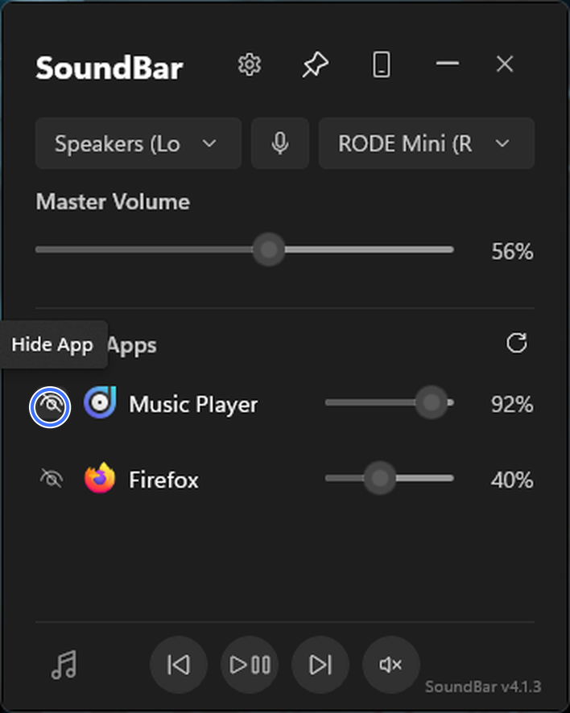<br/><sub>Click the eye to hide an app</sub></td>
    <td align="center">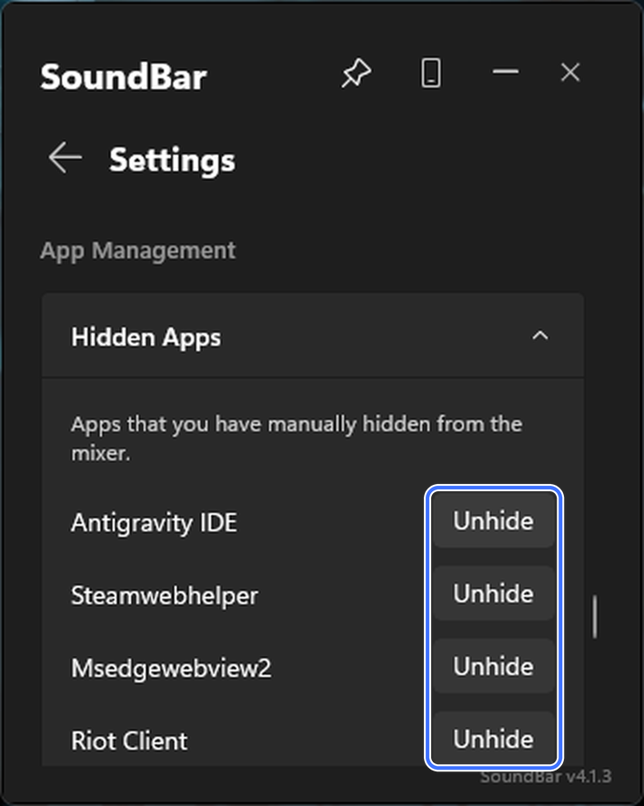<br/><sub>Click <b>Unhide</b> to bring it back. The number shows how many are hidden.</sub></td>
  </tr>
</table>

> **Background apps:** some programs play sound without an open window (for example, apps that sit in the system tray). SoundBar leaves these out to keep the list tidy. To show one, open **Settings > Apps > Background Apps** and click **Allow**.

<sub>[Back to top](#readme-top)</sub>

---

## Speakers, headphones and microphones

Switch where your sound plays, or which microphone you use, straight from the top of the window. There's no need to dig through Windows settings.

<table>
  <tr>
    <td align="center">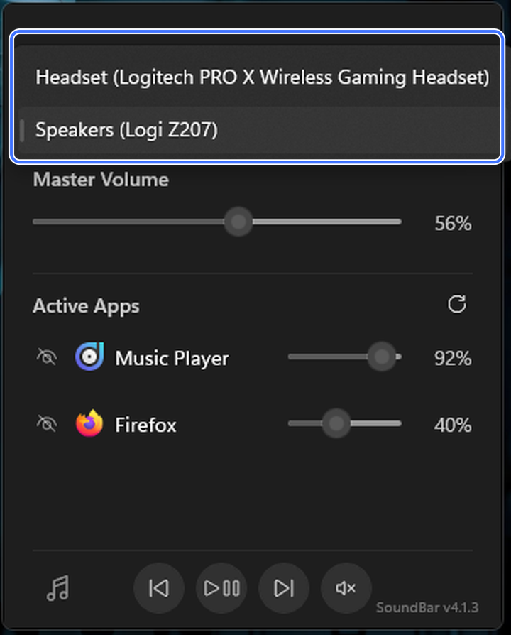<br/><sub>Click the speaker box to choose where sound plays</sub></td>
    <td align="center">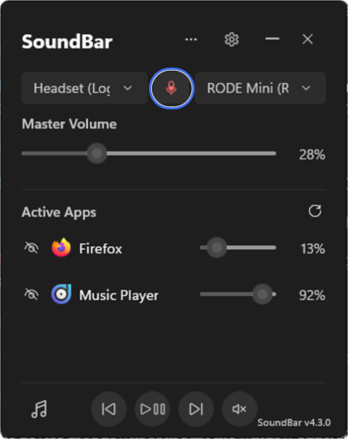<br/><sub>Click the microphone button to mute it. It turns red so you always know.</sub></td>
  </tr>
  <tr>
    <td align="center" colspan="2">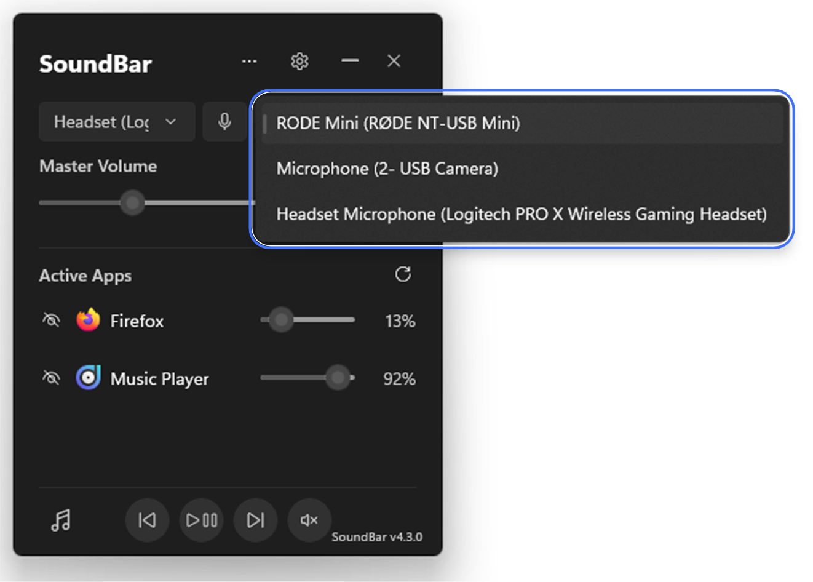<br/><sub>Click the microphone box to choose a microphone</sub></td>
  </tr>
</table>

Using Bluetooth headphones or speakers? You can connect them from SoundBar too. See [Bluetooth](#bluetooth).

<sub>[Back to top](#readme-top)</sub>

---

## Bluetooth

Connect your Bluetooth headphones, speakers and other devices without opening Windows settings. Click the **⋯** button at the top of SoundBar and choose **Bluetooth**.

<table>
  <tr>
    <td width="320">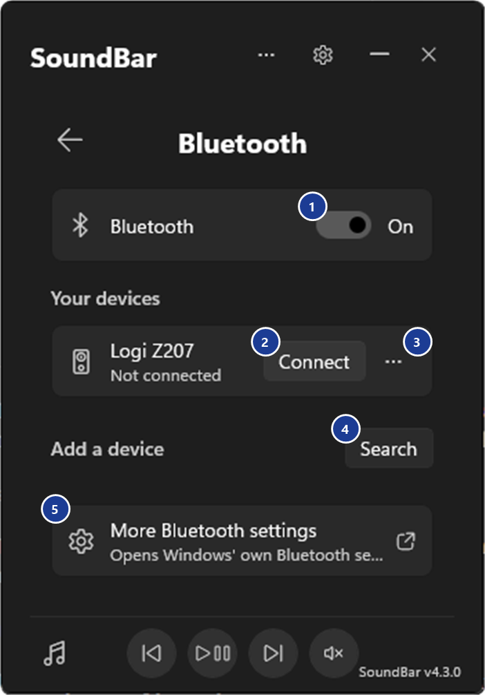</td>
    <td>
      <ol>
        <li><b>Bluetooth on/off:</b> Turn your PC's Bluetooth on or off.</li>
        <li><b>Connect:</b> Connect a paired speaker or headset in one click. SoundBar switches your sound over to it as soon as it's ready. Click <b>Disconnect</b> to let go of it again.</li>
        <li><b>More options:</b> Connect or disconnect, or <b>Remove device</b> to unpair it completely.</li>
        <li><b>Search:</b> Find new devices nearby. Put your device in pairing mode first, then click <b>Pair</b> next to it. If it shows a code, SoundBar asks you to check it matches.</li>
        <li><b>More Bluetooth settings:</b> Opens Windows' own Bluetooth page for anything else.</li>
      </ol>
    </td>
  </tr>
</table>

<table>
  <tr>
    <td align="center">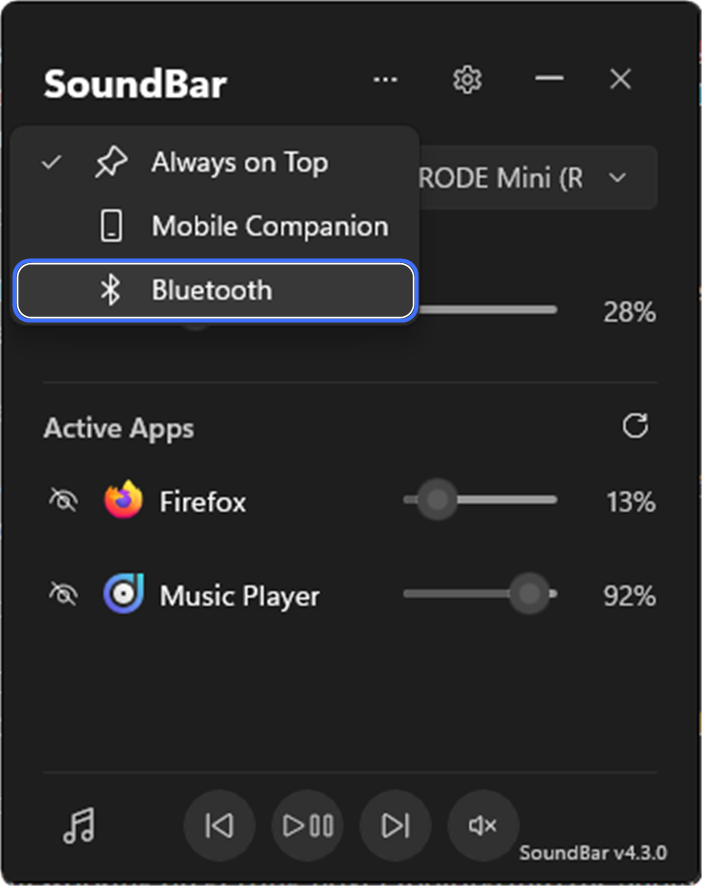<br/><sub>Open the <b>⋯</b> menu and choose <b>Bluetooth</b></sub></td>
    <td align="center">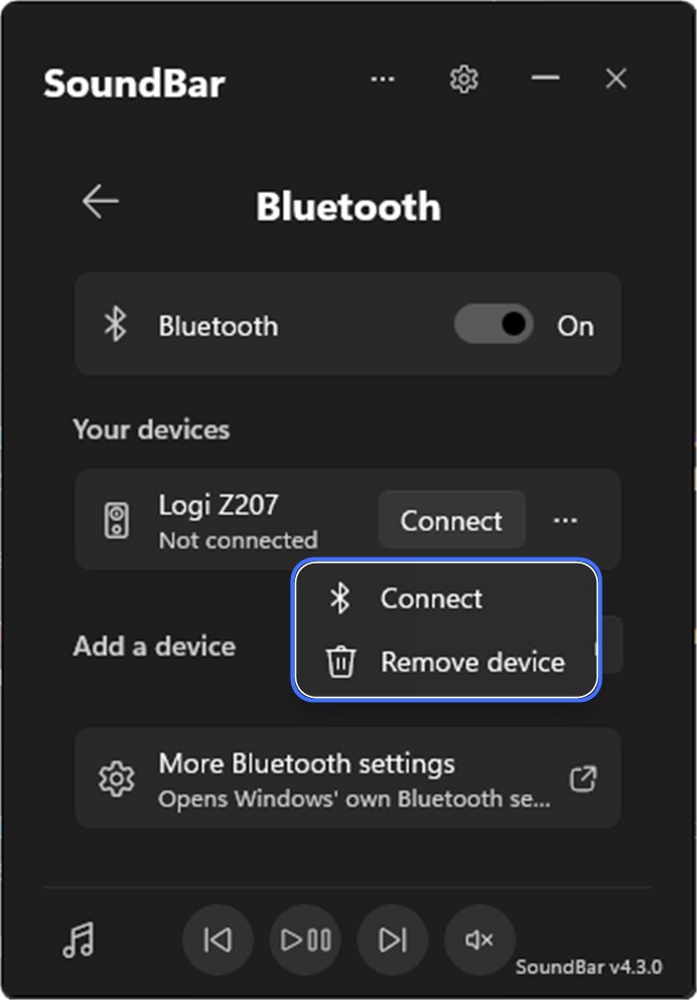<br/><sub>Disconnect without unpairing, or remove the device</sub></td>
  </tr>
</table>

> **Mice, keyboards and game controllers** connect by themselves when you switch them on, so they don't get a **Connect** button. You can still pair and remove them here.

<sub>[Back to top](#readme-top)</sub>

---

## Music player

Click the music note in the bottom corner to swap the app list for a big music player. It shows the album art, song name and artist, and has a timeline you can drag to skip to any part of the song.

It works with anything that shows up in Windows' own media controls, such as Spotify, YouTube in your web browser, and most music and video apps.

<table>
  <tr>
    <td align="center">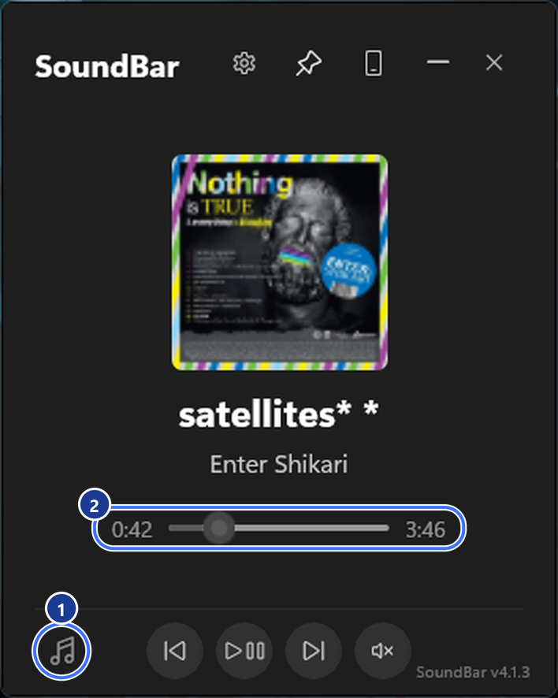<br/><sub><b>1</b> Switch to the music player &nbsp; <b>2</b> Drag to skip through the song</sub></td>
    <td align="center">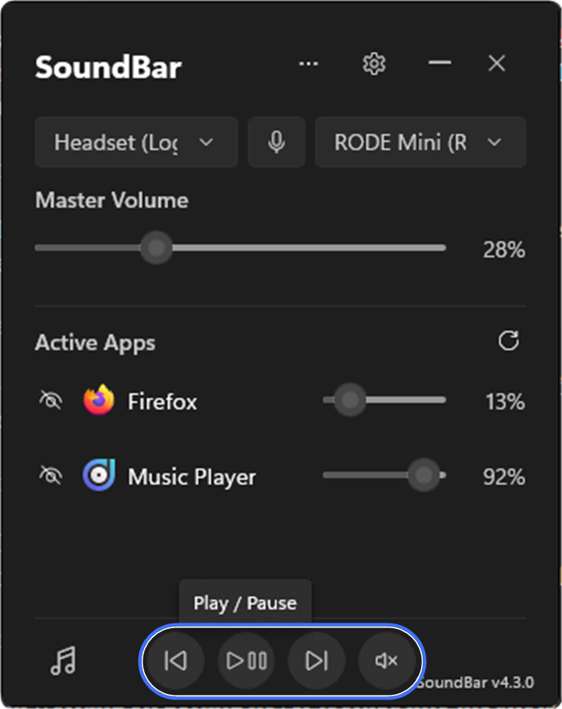<br/><sub>Previous, play/pause, next and mute are always at the bottom</sub></td>
  </tr>
</table>

<sub>[Back to top](#readme-top)</sub>

---

## Control it from your phone

SoundBar has a built-in phone remote. Change volumes, skip songs, mute your microphone or switch speakers from the sofa, with nothing to install from an app store.

**Setting it up (about a minute):**

1. Make sure your phone and PC are on the **same Wi-Fi**.
2. Click the **⋯** button at the top of SoundBar and choose **Mobile Companion**.
3. Click the big **power button**. The first time, Windows will ask for permission. Click **Yes**. You only need to do this once.
4. A **QR code** and a **4-digit code** appear. Point your phone's camera at the QR code and open the link.
5. Type the **4-digit code** on your phone. That's it, you're connected.

<table>
  <tr>
    <td align="center">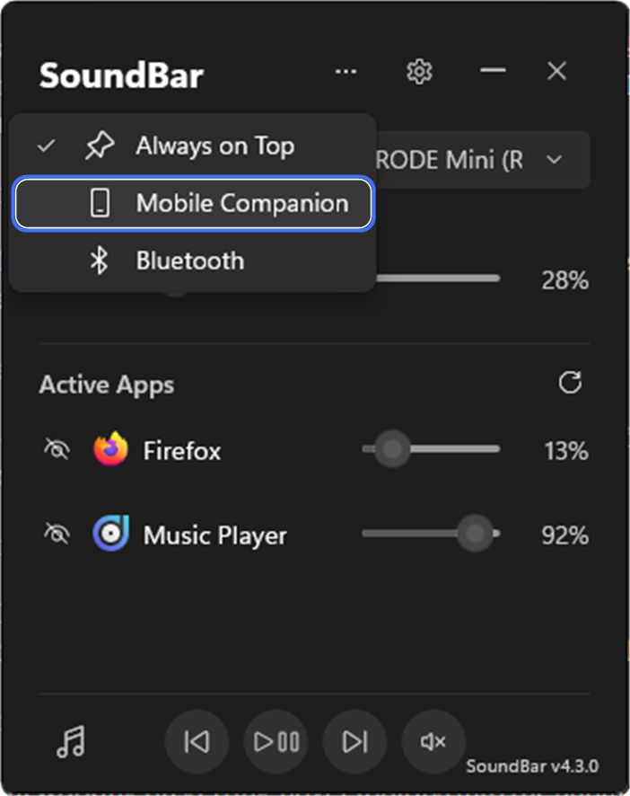<br/><sub>On your PC, open the <b>⋯</b> menu and choose <b>Mobile Companion</b></sub></td>
    <td align="center">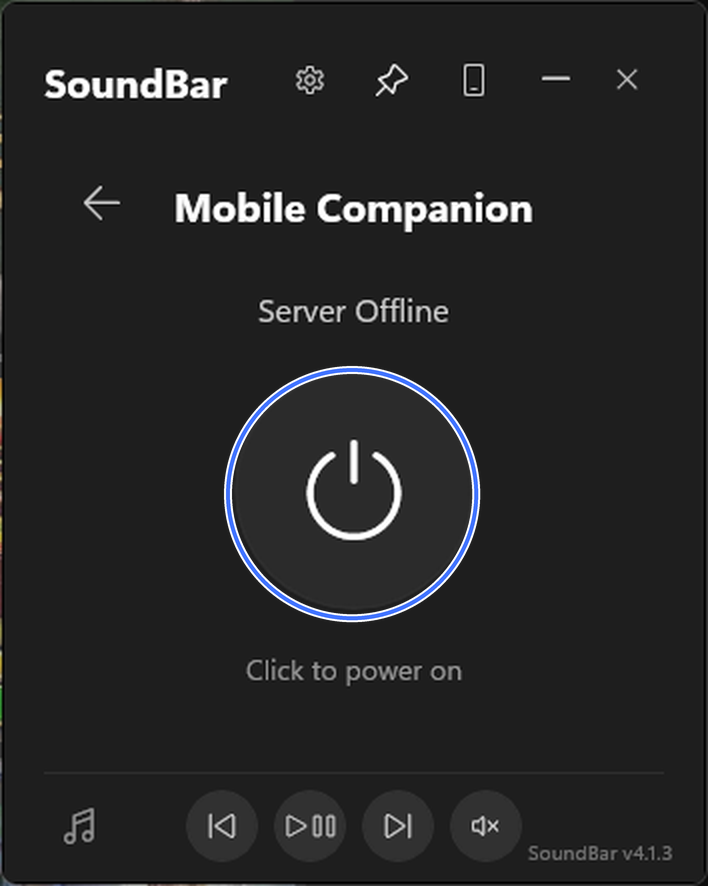<br/><sub>Click the power button to turn it on</sub></td>
    <td align="center">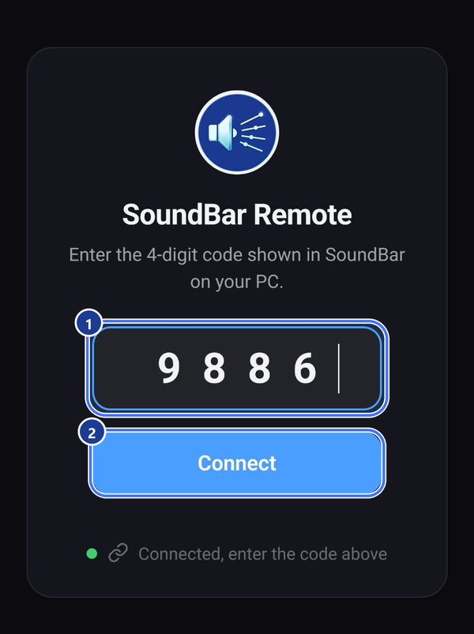<br/><sub>On your phone, <b>1</b> type the code &nbsp; <b>2</b> tap <b>Connect</b></sub></td>
  </tr>
</table>

**What's on your phone:**

<table>
  <tr>
    <td width="320">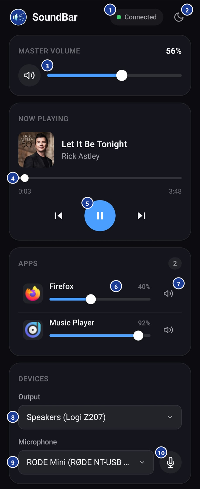</td>
    <td>
      <ol>
        <li><b>Connection:</b> Shows that your phone is connected to your PC.</li>
        <li><b>Light / dark:</b> Switch the remote between light and dark mode.</li>
        <li><b>Master volume:</b> The volume for your whole PC. Tap the speaker to mute everything.</li>
        <li><b>Song timeline:</b> Drag to skip to any part of the song.</li>
        <li><b>Play controls:</b> Previous, play/pause and next.</li>
        <li><b>App volume:</b> Every app on your PC gets its own slider, just like on SoundBar.</li>
        <li><b>App mute:</b> Tap to mute or unmute that app.</li>
        <li><b>Speakers:</b> Choose where your PC's sound plays.</li>
        <li><b>Microphone:</b> Choose which microphone your PC uses.</li>
        <li><b>Microphone mute:</b> Mute your microphone from across the room.</li>
      </ol>
    </td>
  </tr>
</table>

> **Tip: make it feel like a real app.** Once connected, add it to your home screen. On iPhone, tap **Share > Add to Home Screen** in Safari. On Android, tap the **⋮ menu > Add to Home screen** in Chrome.

> **Keeping it safe:** you get a new 4-digit code every time you turn the remote on. Anyone who guesses wrong 5 times is locked out for a while. SoundBar also warns you before turning on if you're on public Wi-Fi (like a café or hotel). Only use the remote on networks you trust.

<sub>[Back to top](#readme-top)</sub>

---

## Make it yours

Everything is in **Settings**. Click the gear icon at the top of the window.

<table>
  <tr>
    <td align="center">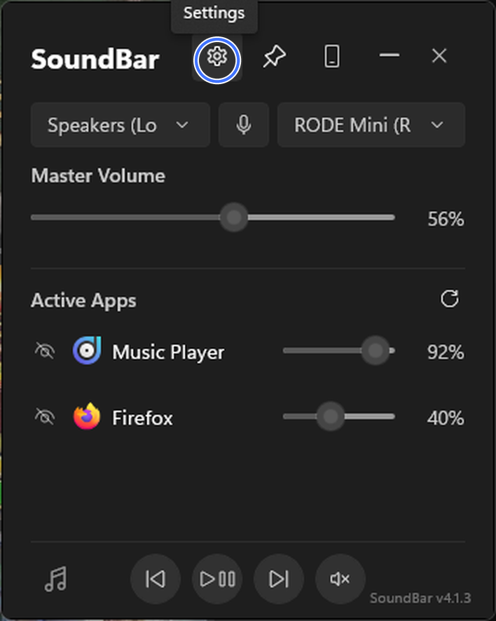<br/><sub>Click the gear to open Settings</sub></td>
    <td align="center">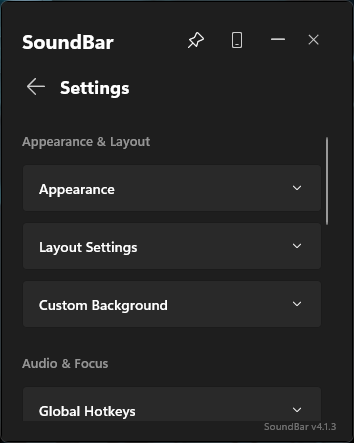<br/><sub><b>1</b> Search for any setting &nbsp; <b>2</b> Click a heading to fold it away</sub></td>
  </tr>
</table>

Settings are sorted into five groups: **Look**, **Main page**, **Sound**, **Apps** and **General**.

- **Search:** start typing in the search bar at the top and only the matching settings are shown. Try "startup", "hotkey" or "mute".
- **Fold away groups you don't need:** click a group's heading to fold it up, and click it again to open it. SoundBar remembers which ones you folded.

<p align="center">
  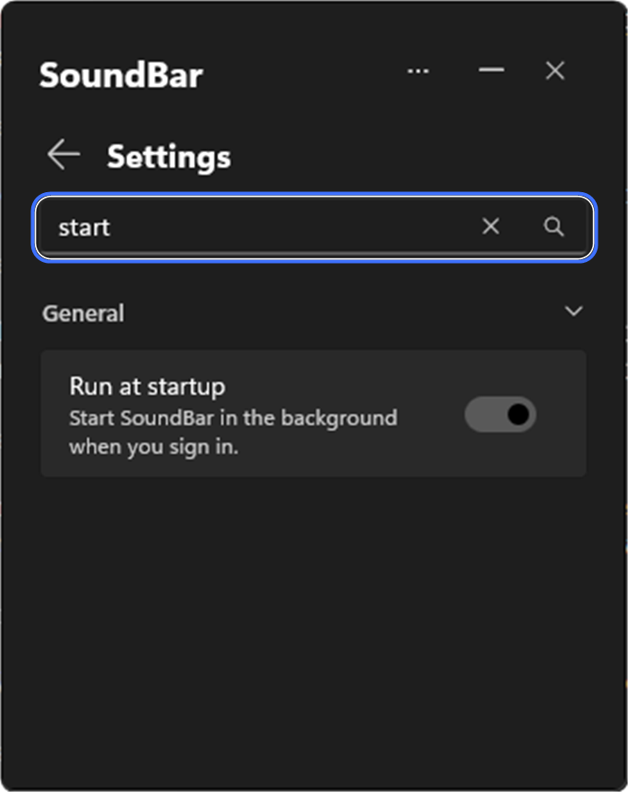
</p>

### Light, dark or match Windows
Choose **Light**, **Dark** or **System** (follow your Windows setting) in **Settings > Look > Theme**.

### Your own wallpaper
Put any picture behind SoundBar. Go to **Settings > Look > Custom background**, click **Open Folder**, drop in a `.jpg` or `.png` picture, then click **Reload**. SoundBar gently dims the picture so the text stays easy to read.

<table>
  <tr>
    <td align="center">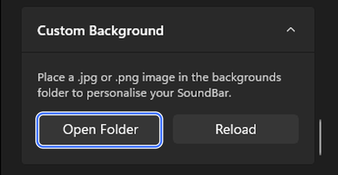<br/><sub>Click <b>Open Folder</b> and add your picture</sub></td>
    <td align="center"><br/><sub>The result</sub></td>
  </tr>
</table>

### See-through window
Want to see what's behind SoundBar? Drag the **Window opacity** slider in **Settings > Look**. The reset button next to it takes it back to 100%.

<p align="center">
  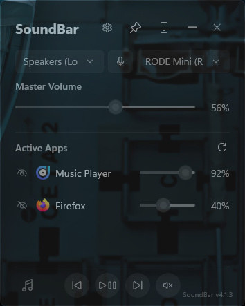
</p>

### Only show what you use
Don't use a microphone? Never switch speakers? Untick any part of the main window in **Settings > Main page**. Hidden parts still work with [keyboard shortcuts](#keyboard-shortcuts).

The same group lets you choose what's in the **⋯** menu. If you'd rather have a separate button for each one at the top of the window, like older versions of SoundBar, tick **Separate buttons (classic title bar)**.

<p align="center">
  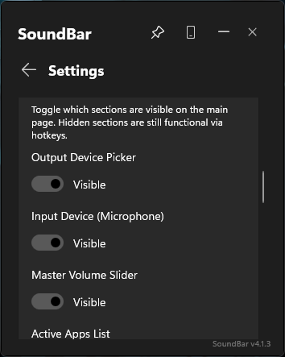
</p>

<sub>[Back to top](#readme-top)</sub>

---

## Keyboard shortcuts

Change the volume of the app you're using **without leaving it**. This is perfect for games and video calls. "The app you're using" means whichever window you're currently in.

| Shortcut | What it does |
|---|---|
| <kbd>Ctrl</kbd> + <kbd>Alt</kbd> + <kbd>↑</kbd> | Turn the app you're using up |
| <kbd>Ctrl</kbd> + <kbd>Alt</kbd> + <kbd>↓</kbd> | Turn the app you're using down |
| <kbd>Ctrl</kbd> + <kbd>Alt</kbd> + <kbd>M</kbd> | Mute or unmute the app you're using |
| <kbd>Ctrl</kbd> + <kbd>Alt</kbd> + <kbd>I</kbd> | Mute or unmute your microphone |

You can change any of these in **Settings > Sound > Global hotkeys**. SoundBar also highlights the app your shortcuts will control, so you always know what you're changing. You can turn this highlight on or off with **Active app highlight** in **Settings > Look**.

<table>
  <tr>
    <td align="center">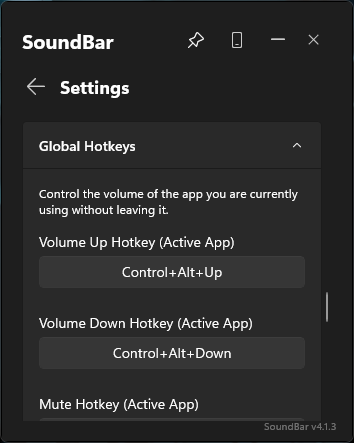<br/><sub>Pick your own shortcuts</sub></td>
    <td align="center">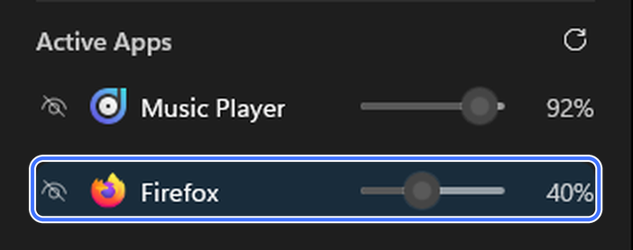<br/><sub>The app you're using is highlighted</sub></td>
  </tr>
</table>

<sub>[Back to top](#readme-top)</sub>

---

## Handy extras

### Always on top
Click the **⋯** button at the top of the window and choose **Always on Top** to keep SoundBar in front of everything else. A tick shows it's on. Choose it again to turn it off. (With the classic title bar, click the **pin** instead.)

<p align="center">
  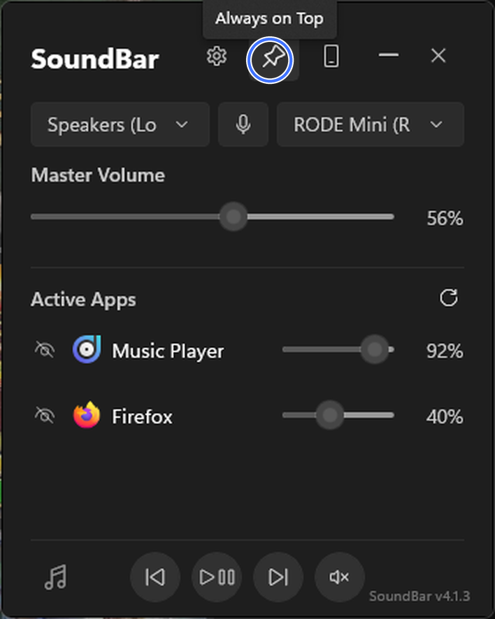
</p>

### Start with Windows
Turn on **Run at startup** in **Settings > General** and SoundBar will be ready whenever you turn on your PC. To add a shortcut to your desktop, click **Create** next to **Desktop shortcut**.

<p align="center">
  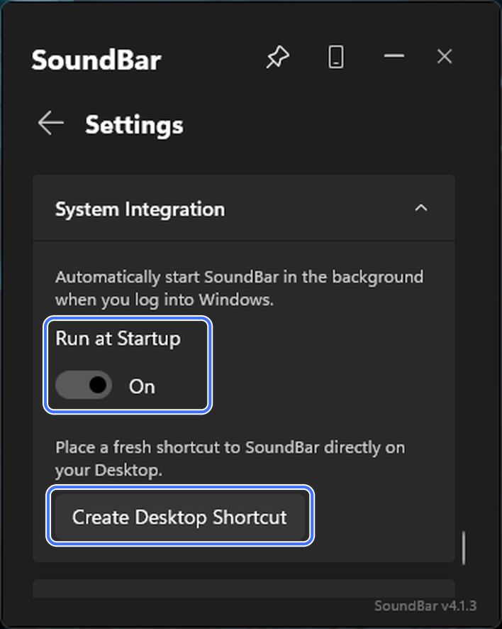
</p>

### Do Not Disturb
Silence all Windows notification and system sounds with one switch in **Settings > Sound > Do Not Disturb**. Your music and games keep playing. To change which sounds Windows plays, click **Open** next to **System sounds**.

### Loudness warning
If your volume stays above 85% for a long time, SoundBar can show a friendly warning to protect your ears. Turn it on in **Settings > Sound > Loudness warning**.

### Automatic updates
SoundBar checks for a new version each time it starts. When one is available, an **Update Available** button appears at the top. Click it once and SoundBar updates itself. Your settings and wallpapers are kept.

To see what changed, click the version number in the bottom corner or open **Settings > General > About SoundBar**.

<table>
  <tr>
    <td align="center">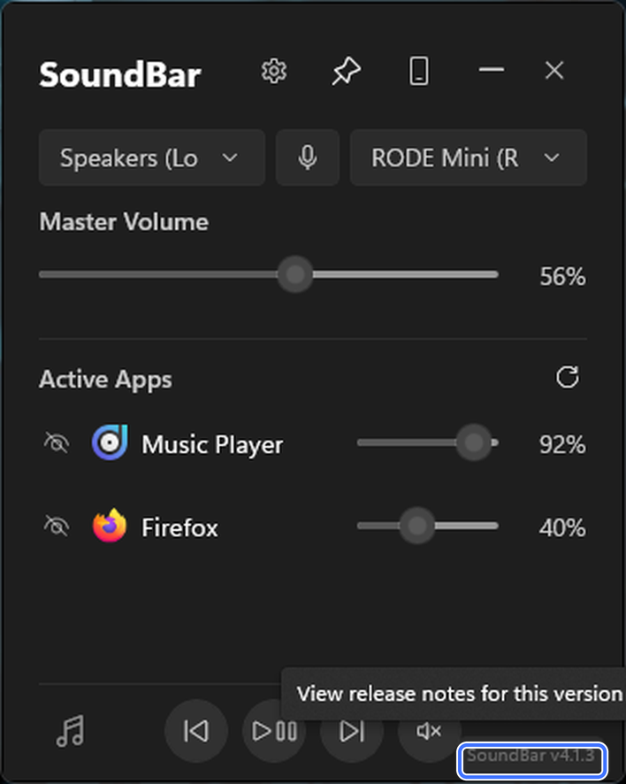<br/><sub>Click the version number</sub></td>
    <td align="center">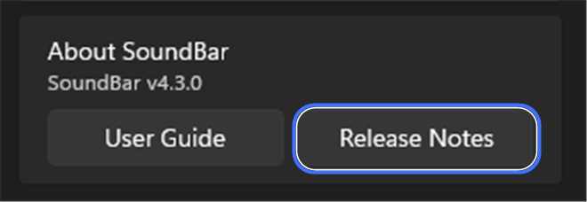<br/><sub>Or use <b>Release Notes</b> in Settings</sub></td>
  </tr>
</table>

<sub>[Back to top](#readme-top)</sub>

---

## How to install

**You'll need:** a 64-bit PC running Windows 10 (version 1809 or newer) or Windows 11.

### Option 1: Install with Winget (recommended)
Winget is Windows' built-in app installer. It also makes updating easy.

1. Click the **Start** button, type **Terminal** (or **PowerShell**) and open it.
2. Copy and paste the line below, then press **Enter**:

```powershell
winget install levon2805.SoundBar
```

### Option 2: Download it
SoundBar is a single folder. There's nothing else to install.

1. Go to the [**Releases**](../../releases) page.
2. Download the latest **`SoundBar.zip`**.
3. Right-click the zip, choose **Extract All**, and put the folder anywhere you like.
4. Open the folder and double-click **`SoundBar.exe`**.

> **Seeing a "Windows protected your PC" message?** This is normal for new apps from independent developers. Click **More info**, then **Run anyway**. You'll only see it the first time.

<sub>[Back to top](#readme-top)</sub>

---

## Common questions

<details>
<summary><b>An app isn't showing up in the list</b></summary>

Apps only appear once they're actually playing sound. Start playing something, then click the refresh arrow next to **Active Apps**. If it still doesn't appear, check **Settings > Apps > Hidden Apps** (you may have hidden it) and **Settings > Apps > Background Apps** (click **Allow** to show it).
</details>

<details>
<summary><b>My phone won't connect</b></summary>

- Make sure your phone and PC are on the **same Wi-Fi** network. Phones on mobile data can't connect.
- Make sure the remote is turned on (the power button in **⋯ > Mobile Companion**).
- If Windows has your network set to **Public**, set it to **Private** in **Windows Settings > Network & internet**. Only do this on your own home network.
- Typed the code wrong too many times? Wait a few minutes and try again.
</details>

<details>
<summary><b>Where are my settings saved?</b></summary>

In `%AppData%\SoundBar`. Paste that into the File Explorer address bar to open it. Your wallpapers are in the `Backgrounds` folder inside it. Updating SoundBar never touches this folder.
</details>

<details>
<summary><b>How do I uninstall SoundBar?</b></summary>

- **Installed with Winget:** run `winget uninstall levon2805.SoundBar` in Terminal.
- **Downloaded zip:** turn off **Run at startup** in **Settings > General**, close SoundBar, then delete the folder.
</details>

<details>
<summary><b>Advanced settings</b></summary>

A few extra options (such as the network port the phone remote uses) can be changed by hand. Open **Settings > General > Advanced settings file** and click **Open**. Changes apply as soon as you save the file.

<p align="center">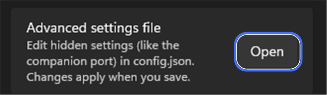</p>
</details>

<sub>[Back to top](#readme-top)</sub>

---

## For developers

SoundBar is built natively with the Windows App SDK (WinUI 3) on .NET 8.

**Project layout:**
* `src/SoundBar/` contains the main WinUI 3 application (the phone remote's web app is in `src/SoundBar/wwwroot/`).
* `tests/SoundBar.Tests/` contains the xUnit automated tests.
* `ReleaseTools/` contains internal release and update-signing utilities.
* `docs/images/` contains the screenshots used in this README.

Open `SoundBar.slnx` or `src/SoundBar/SoundBar.csproj` in Visual Studio 2022 (or newer) to get started.

### Running automated tests
We use **xUnit** and **Moq** to test the internal services and debouncing logic.

The simplest way is Visual Studio's **Test Explorer** (`Test > Test Explorer > Run All Tests`).

From the command line, plain `dotnet test` can fail with `ExpandPriContent` MSBuild errors (a known Windows App SDK tooling quirk). Build with Visual Studio's MSBuild first, then run the tests without rebuilding:

```powershell
& "<Visual Studio>\MSBuild\Current\Bin\MSBuild.exe" tests/SoundBar.Tests/SoundBar.Tests.csproj -p:Configuration=Debug -p:Platform=x64 -restore
dotnet test tests/SoundBar.Tests/SoundBar.Tests.csproj -p:Platform=x64 --no-build
```

<sub>[Back to top](#readme-top)</sub>
